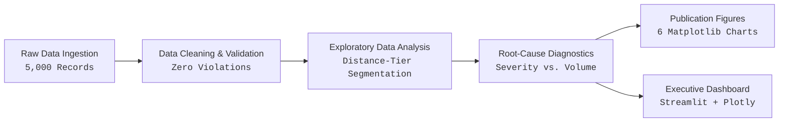

# Logistics Delay Root-Cause Analyzer

An end-to-end data analytics and operational intelligence system diagnosing **where, when, and why shipment delays occur** across a simulated US freight logistics network (5,000 shipments, Q1 2024).

The project demonstrates a production-grade analytics lifecycle:  
**Raw Data Generation → Automated Data Cleaning & Validation → Exploratory Data Analysis (EDA) → Root-Cause & Business Insight Analysis → Publication-Quality Visualizations → Interactive Executive Streamlit Dashboard.**

---

## 1. Project Overview

In freight and parcel logistics, on-time delivery (OTD) is the primary determinant of customer satisfaction, contract fulfillment, and carrier retention. Even a moderate delivery delay rate erodes profit margins through customer support overhead, contractual Service Level Agreement (SLA) penalties, and customer churn.

This project addresses the central business question:  
> **"Why are shipments getting delayed across our network, where are delays concentrated, and what operational adjustments show mathematical sensitivity for improvement?"**

By examining 5,000 shipments across 20 domestic freight corridors, this study moves beyond aggregate delay rates to conduct a multi-dimensional diagnostic across origin fulfillment centers, destination markets, distance tiers, logistics carriers, weather conditions, and highway traffic congestion.



---

## 2. Business Problem

Delivery delays are rarely uniform across a logistics network. Treating delays as an undifferentiated network-wide issue leads to misdirected capital investments—such as optimizing warehouse workflows where transit bottlenecks dominate, or penalizing carriers for delays caused by upstream fulfillment delays.

This analysis systematically isolates:
1. **Geographic & Corridor Concentration (WHERE):** Identifying specific origin warehouses and cross-country corridors that generate disproportionate delay volumes.
2. **Temporal Patterns (WHEN):** Evaluating day-of-week dispatch volumes and monthly variations to separate operational bottlenecks from calendar effects.
3. **Operational Drivers (WHY):** Assessing carrier transit speed versus delivery window commitments, severe weather disruptions, and urban traffic congestion.
4. **Severity vs. Volume Tradeoff (WHICH):** Differentiating between acute high-rate disruptions (e.g., severe storms affecting small volumes) and chronic high-volume drivers (e.g., clear-weather cross-country lanes generating the bulk of total delayed packages).
5. **Hypothetical Scenario Sensitivity:** Mathematically modeling the impact of targeted operational adjustments (facility dispatch alignment and long-haul SLA buffer realignments).

---

## 3. Dataset

The project analyzes a synthetic dataset representing a domestic hub-and-spoke US logistics network operating in **Q1 2024 (January 1 – March 31, 2024)**. 

> [!NOTE]
> **Synthetic Data Disclosure:** This dataset is simulated using reproducible probabilistic distributions (`src/generate_data.py`, seed `42`). It is designed to model realistic operational tradeoffs and is **not** real company proprietary data.

### Schema & Feature Dictionary (16 Columns)

| Field Name | Data Type | Description | Operational Domain / Range |
| :--- | :--- | :--- | :--- |
| `Order_ID` | `string` | Unique shipment tracking identifier | `ORD-00001` to `ORD-05000` |
| `Order_Date` | `datetime` | Timestamp when the customer order was placed | 2024-01-01 to 2024-03-31 |
| `Origin_Warehouse` | `string` | Origin fulfillment center facility | `WH-East`, `WH-West`, `WH-North`, `WH-South` |
| `Destination_City` | `string` | Destination metropolitan market | `Atlanta`, `Chicago`, `Dallas`, `Los Angeles`, `New York` |
| `Distance_KM` | `float64` | Haul distance between warehouse and city (km) | 55.4 km to 4,024.9 km |
| `Package_Weight_KG` | `float64` | Package billable weight in kilograms | 0.5 kg to 49.9 kg |
| `Carrier` | `string` | Assigned third-party freight/parcel carrier | `ExpressAir`, `FastTrack`, `SwiftCargo` |
| `Weather_Condition` | `string` | Dominant weather during transit leg | `Clear`, `Rain`, `Fog`, `Storm` |
| `Traffic_Level` | `string` | Highway congestion index during delivery leg | `Low`, `Medium`, `High` |
| `Warehouse_Processing_Days` | `int64` | Fulfillment staging and processing duration | 1 to 3 days |
| `Ship_Date` | `datetime` | Facility dispatch timestamp | `Order_Date + Warehouse_Processing_Days` |
| `Promised_Delivery_Date` | `datetime` | Customer delivery SLA commitment date | Distance- and carrier-adjusted promised date |
| `Transit_Days` | `int64` | Physical transit duration from dispatch to delivery | 1 to 9 days |
| `Actual_Delivery_Date` | `datetime` | Final physical delivery timestamp | `Ship_Date + Transit_Days` |
| `Delay_Days` | `int64` | Days past promised delivery date | `max(0, Actual_Delivery_Date - Promised_Delivery_Date)` |
| `Delayed` | `int64` | Binary delivery delay indicator | `1` if `Delay_Days > 0`, else `0` |

---

## 4. Data Quality & Cleaning Pipeline

The data cleaning pipeline (`src/clean_data.py`) enforces strict validation rules to guarantee analytical integrity prior to downstream modeling and reporting (`notebooks/01_data_cleaning_and_validation.ipynb`).

```
Raw Input: data/raw/shipments_raw.csv (5,000 rows, 16 cols)
  ├── Null Value Audit: 0 missing fields across all attributes
  ├── Duplicate Audit: 0 duplicate Order_IDs or identical rows
  ├── Chronology Validation:
  │   ├── Order_Date <= Ship_Date (100% compliant)
  │   ├── Ship_Date <= Actual_Delivery_Date (100% compliant)
  │   └── Promised_Delivery_Date >= Order_Date (100% compliant)
  ├── Physical Boundary Validation:
  │   ├── Distance_KM ∈ [50, 4500] km (0 violations)
  │   ├── Package_Weight_KG ∈ [0.1, 50.0] kg (0 violations)
  │   ├── Warehouse_Processing_Days ∈ [1, 5] days (0 violations)
  │   └── Transit_Days ∈ [1, 14] days (0 violations)
  ├── Categorical Schema Audit:
  │   ├── Warehouses (4 valid), Cities (5 valid), Carriers (3 valid)
  │   └── Weather (4 valid), Traffic (3 valid)
  └── Mathematical Target Validation:
      ├── Delay_Days == max(0, Actual - Promised) (0 mismatches)
      └── Delayed == (Delay_Days > 0) (0 mismatches)
Processed Output: data/processed/shipments_cleaned.csv (5,000 rows, 16 cols)
```

The raw dataset is preserved immutably. Cleaned data is saved separately with verified cryptographic hash integrity (SHA-256: `2e5b6c6f...`).

---

## 5. Exploratory Data Analysis (EDA)

The exploratory analysis (`notebooks/02_exploratory_data_analysis.ipynb`) examines shipment volume and delay distribution across operational dimensions. To avoid confounding distance with carrier or weather performance, observations are segmented into standard **Distance Tiers**:
- **Short Haul:** $< 600\text{ km}$ ($N = 1,179$)
- **Medium Haul:** $600\text{ to }1,500\text{ km}$ ($N = 1,205$)
- **Long Haul:** $> 1,500\text{ km}$ ($N = 2,616$)

### A. Warehouse Fulfillment Performance
Fulfillment centers exhibit substantial variance in delay outcomes and internal dispatch times:
- **WH-West (1,261 shipments):** Highest observed delay rate at **22.52%** (284 delays). Driven primarily by long-haul transcontinental dispatches to New York (avg transit: 4.05 days).
- **WH-East (1,738 shipments):** Highest delayed shipment count at **312 delays** (17.95% delay rate), handling the network's largest shipment volume.
- **WH-North (1,031 shipments):** Exhibits a facility processing bottleneck. Average internal warehouse processing time is **1.70 days** (with 59.36% of orders taking $\ge 2$ days), compared to 1.20–1.22 days at other facilities. Delay rate: **14.16%** (146 delays).
- **WH-South (970 shipments):** Best-performing fulfillment center with a **3.92%** delay rate (38 delays) and 1.20 days average processing.

### B. Route & Corridor Diagnostics
Network delays are heavily concentrated along specific geographic lanes:
- **Transcontinental Lanes:**
  - `WH-West → New York`: **53.30%** delay rate (210 delays / 394 shipments; avg transit: 6.09 days).
  - `WH-East → Los Angeles`: **51.53%** delay rate (219 delays / 425 shipments; avg transit: 6.04 days).
  - Combined, these two corridors represent only **16.38% of network volume (819 shipments)** but account for **55.00% of all network delays (429 of 780 delays)**.
- **Regional Bottleneck:**
  - `WH-North → Chicago`: **29.19%** delay rate (61 delays / 209 shipments), despite being a short-haul route (avg physical transit: 1.24 days), heavily affected by facility dispatch delays.

### C. Carrier Performance by Distance Tier
Comparing carriers without distance segmentation introduces an "apples-to-oranges" distortion:
- **ExpressAir:** Fastest physical transit speed in the network (**2.38 days avg transit** vs. 3.18d FastTrack, 3.50d SwiftCargo), yet records the highest overall delay rate (**32.42%**, 330/1,018).
  - Long Haul: **39.56%** delay rate (199 / 503)
  - Short Haul: **38.31%** delay rate (95 / 248)
  - Medium Haul: **13.48%** delay rate (36 / 267)
- **FastTrack:** Most reliable performer overall with an aggregate delay rate of **7.74%** (138/1,782).
  - Long Haul: 11.03% (103 / 934) | Medium Haul: 2.34% (10 / 427) | Short Haul: 5.94% (25 / 421)
- **SwiftCargo:** Balanced ground carrier with an aggregate delay rate of **14.18%** (312/2,200).
  - Long Haul: 17.22% (203 / 1,179) | Medium Haul: 4.11% (21 / 511) | Short Haul: 17.25% (88 / 510)

### D. Weather Disruption: Severity vs. Volume
- **Storms (Acute Severity):** Generate a **72.18%** delay rate (96 delays / 133 shipments). On short-haul routes, storm events result in a **100.0%** observed delay rate (36 / 36 shipments).
- **Clear Conditions (Mass Volume):** While clear weather has a low delay rate of **12.35%**, it accounts for **435 of the 780 total network delays (55.77%)** because 70.46% of all shipments (3,523) travel under clear conditions.
- **Rain & Fog:** Moderate impact with delay rates of **17.77%** (177 / 996) and **20.69%** (72 / 348) respectively.

### E. Traffic Congestion Sensitivity
- On **Short-Haul Routes (<600 km)**, high traffic congestion is associated with an observed delay rate of **30.17%** (70 / 232), more than double the **14.76%** rate observed under low traffic (49 / 332). Single-day deliveries have narrow schedule buffers.
- On **Long-Haul Routes (>1,500 km)**, traffic level differences are less pronounced (High: 26.58% vs. Low: 17.56%), as multi-day linehaul schedules absorb highway traffic variance.

### F. Package Weight & Temporal Distributions
- **Package Weight:** Delay rates remain virtually flat across weight bands (0–10 kg: 15.65%, 10–25 kg: 15.11%, 25–50 kg: 16.03%), demonstrating that package weight is not an observed delay differentiator in this network.
- **Day of Week:** Monday experiences the highest order intake (1,133 shipments), but delay rates remain stable across weekdays and weekends (14.08% to 16.37%).
- **Seasonality (Q1):** January recorded 16.59% (301 delays), February 16.06% (253 delays), and March 14.03% (226 delays).

---

## 6. Root-Cause & Business Insight Analysis

Notebook 03 (`notebooks/03_root_cause_and_business_insights.ipynb`) synthesizes exploratory findings into evidence-based operational diagnostics.

> [!IMPORTANT]
> **Analytical Tone & Causation Standard:** In accordance with rigorous data science principles, observed statistical patterns are reported as associations rather than definitive real-world causation.

### Three Major Observed Delay Patterns

#### Pattern 1: Transcontinental Corridor Congestion & Long-Haul SLA Compression
Cross-country dispatches between Coastal hubs (`WH-West → New York` and `WH-East → Los Angeles`) average >6.0 days in physical transit. Over half of these shipments miss customer promised dates (52.38% delay rate), generating **55.00% (429/780)** of all network delays. Long-haul delivery promises appear tightly compressed relative to physical coast-to-coast linehaul requirements.

#### Pattern 2: Fulfillment Staging Bottleneck at WH-North Facility
Shipments originating from `WH-North` average **1.70 days** in internal warehouse processing—0.50 days longer than the network benchmark. Because delivery SLA clocks begin at order placement, multi-day staging consumes downstream transit buffer before carrier handoff. This pattern is particularly evident on `WH-North → Chicago` (29.19% delay rate despite 1.24-day physical transit).

#### Pattern 3: The ExpressAir Delivery Window Paradox & Carrier Weather Vulnerability
ExpressAir maintains the network's fastest physical transit speed (2.38 days avg), yet records an observed delay rate of 32.42% (and 39.56% on long-haul routes). This indicates an operational mismatch where customer delivery windows (tightened by 2 days for premium air service) exceed the physical capabilities of long-distance handling. Additionally, SwiftCargo demonstrates heightened vulnerability to severe storms (74.07% storm delay rate, 40/54).

---

### Operational Priority Matrix (Severity vs. Volume)

To guide operational focus, 10 key operational segments are mapped across a 4-quadrant decision matrix balancing **Delay Rate (Severity)** against **Delayed Shipment Count (Volume)**:

| Operational Segment | Total Volume ($N$) | Delayed Count ($n$) | Delay Rate (%) | Assigned Priority Quadrant |
| :--- | :---: | :---: | :---: | :--- |
| **WH-East → LA (ExpressAir)** | 87 | 87 | 100.00% | **High Severity / High Delayed Volume** |
| **WH-West → NY (ExpressAir)** | 77 | 77 | 100.00% | **High Severity / High Delayed Volume** |
| **WH-West → NY (SwiftCargo)** | 176 | 84 | 47.73% | **High Severity / High Delayed Volume** |
| **WH-East → LA (SwiftCargo)** | 201 | 87 | 43.28% | **High Severity / High Delayed Volume** |
| **SwiftCargo in Storm** | 54 | 40 | 74.07% | **High Severity / Lower Delayed Volume** |
| **WH-North → Chicago (All)** | 209 | 61 | 29.19% | **High Severity / Lower Delayed Volume** |
| **WH-West → NY (FastTrack)** | 141 | 49 | 34.75% | **High Severity / Lower Delayed Volume** |
| **WH-East → LA (FastTrack)** | 137 | 45 | 32.85% | **High Severity / Lower Delayed Volume** |
| **ExpressAir in Clear Weather** | 715 | 196 | 27.41% | **High Severity / High Delayed Volume** |
| **FastTrack in Clear Weather** | 1,246 | 70 | 5.62% | **Lower Severity / High Delayed Volume** |

*Thresholds: Delayed Volume split = 60 delays; Severity threshold = Network Baseline Delay Rate (15.60%).*

---

## 7. Key Network Metrics

Summary of verified baseline performance across the 5,000 shipments:

| Metric | Verified Value | Analytical Definition / Scope |
| :--- | :---: | :--- |
| **Total Shipments** | **5,000** | Total audited shipment records in Q1 2024 |
| **On-Time Deliveries** | **4,220** | Shipments delivered on or before Promised Delivery Date |
| **On-Time Delivery (OTD) Rate** | **84.40%** | `(4,220 / 5,000) * 100` |
| **Delayed Shipments** | **780** | Shipments delivered after Promised Delivery Date |
| **Network Delay Rate** | **15.60%** | `(780 / 5,000) * 100` |
| **Average Delay (Delayed Shipments)** | **1.23 days** | Mean `Delay_Days` among the 780 delayed packages (exact: `1.2333` d) |
| **Maximum Observed Delay** | **4 days** | Maximum `Delay_Days` recorded in the dataset |
| **Average Physical Transit** | **3.16 days** | Mean duration between `Ship_Date` and `Actual_Delivery_Date` (`3.1554` d) |

---

## 8. Hypothetical Scenario Simulations

Notebook 03 incorporates two hypothetical sensitivity simulations to evaluate the mathematical elasticity of network delay rates under targeted operational adjustments.

> [!WARNING]
> **Methodological Disclaimer:** These calculations are hypothetical sensitivity models based on historical Q1 2024 data. They evaluate mathematical sensitivity under ceteris paribus assumptions and do **not** constitute predictive forecasts, machine learning predictions, or guaranteed real-world outcomes.

### Scenario 1: WH-North Warehouse Processing Benchmark Alignment
- **Explicit Assumption:** WH-North internal processing currently averages 1.70 days. We model the hypothetical effect of aligning WH-North dispatch times toward network facility benchmarks (~1.10–1.21 days) by **reducing processing duration by 1 day for shipments where processing exceeded 1 day** (flooring processing at 1 day minimum).
- **Recalculation Logic:**
  $$\text{Actual\_Delivery\_Date}_{\text{sim1}} = \text{Actual\_Delivery\_Date} - 1\text{ day (where WH-North \& Processing > 1)}$$
  $$\text{Delay\_Days}_{\text{sim1}} = \max(0, \text{Actual\_Delivery\_Date}_{\text{sim1}} - \text{Promised\_Delivery\_Date})$$
- **Simulated Outcomes:**
  - WH-North facility average processing falls from **1.70 days → 1.10 days**.
  - WH-North facility delays drop from **146 → 38** (delay rate falls from 14.16% → 3.69%).
  - `WH-North → Chicago` corridor delays drop from **61 → 20** (delay rate falls from 29.19% → 9.57%).
  - Network-wide delays drop from **780 → 672**, reducing network delay rate from **15.60% → 13.44%** (a shift of **$-108$ delays**).

---

### Scenario 2: ExpressAir Long-Haul SLA Promise Window Alignment
- **Explicit Assumption:** ExpressAir operates with a 2-day delivery window reduction. On long-haul routes (>1,500 km), physical cross-country transit takes ~3.6–4.1 days on average. We model the hypothetical effect of **adding a +1 day operational buffer to the customer promised delivery date for ExpressAir shipments exceeding 1,500 km** (adjusting promised delivery from 5 days to 6 days).
- **Recalculation Logic:**
  $$\text{Promised\_Delivery\_Date}_{\text{sim2}} = \text{Promised\_Delivery\_Date} + 1\text{ day (where Carrier = ExpressAir \& Distance > 1500 km)}$$
  $$\text{Delay\_Days}_{\text{sim2}} = \max(0, \text{Actual\_Delivery\_Date} - \text{Promised\_Delivery\_Date}_{\text{sim2}})$$
- **Simulated Outcomes:**
  - ExpressAir long-haul delays drop from **199 → 56** (delay rate falls from 39.56% → 11.13%).
  - Network-wide delays drop from **780 → 637**, reducing network delay rate from **15.60% → 12.74%** (a shift of **$-143$ delays**).

---

### Combined Simulation Scorecard

When both independent adjustments are evaluated simultaneously:

| Operational Scenario | Delayed Shipments | Simulated Delay Rate | Simulated Delay Shift | Methodological Status |
| :--- | :---: | :---: | :---: | :--- |
| **Baseline (Current Observed State)** | **780** | **15.60%** | — | Observed Historical Baseline |
| **Scenario 1: WH-North Alignment** | **672** | **13.44%** | $-108$ delays ($-1.70\text{ pp}$) | Hypothetical Sensitivity Model |
| **Scenario 2: ExpressAir SLA Alignment** | **637** | **12.74%** | $-143$ delays ($-2.86\text{ pp}$) | Hypothetical Sensitivity Model |
| **Combined Scenarios (1 + 2 Jointly)** | **536** | **10.72%** | **$-244$ delays ($-4.88\text{ pp}$)** | Hypothetical Sensitivity Model |

---

## 9. Publication-Quality Visualization Suite

The repository includes 6 standalone Matplotlib figures (`reports/figures/`) generated programmatically via `src/generate_charts.py`. All figures are 100% dynamically calculated from the processed dataset:

| Figure | File Name | Chart Type & Key Visualization Focus |
| :---: | :--- | :--- |
| **01** | [`01_network_delay_overview.png`](file:///c:/Users/Niraj/Documents/Logistics%20Delay%20Root-Cause%20Analyzer/reports/figures/01_network_delay_overview.png) | Horizontal stacked benchmark bar showing 84.4% on-time vs. 15.6% delayed volume, with annotated duration averages. |
| **02** | [`02_route_delay_performance.png`](file:///c:/Users/Niraj/Documents/Logistics%20Delay%20Root-Cause%20Analyzer/reports/figures/02_route_delay_performance.png) | Horizontal ranked bar of all 20 network corridors, highlighting transcontinental concentration (>51%) vs. network baseline. |
| **03** | [`03_carrier_by_distance_tier.png`](file:///c:/Users/Niraj/Documents/Logistics%20Delay%20Root-Cause%20Analyzer/reports/figures/03_carrier_by_distance_tier.png) | Grouped bar chart illustrating the ExpressAir transit-versus-SLA paradox across Short, Medium, and Long haul tiers. |
| **04** | [`04_weather_by_distance_tier.png`](file:///c:/Users/Niraj/Documents/Logistics%20Delay%20Root-Cause%20Analyzer/reports/figures/04_weather_by_distance_tier.png) | Grouped bar chart comparing weather impacts by distance tier, detailing 100% short-haul storm delays. |
| **05** | [`05_traffic_by_distance_tier.png`](file:///c:/Users/Niraj/Documents/Logistics%20Delay%20Root-Cause%20Analyzer/reports/figures/05_traffic_by_distance_tier.png) | Grouped bar chart isolating the doubling of delay rates on short-haul routes under high traffic congestion. |
| **06** | [`06_high_volume_vs_high_severity_matrix.png`](file:///c:/Users/Niraj/Documents/Logistics%20Delay%20Root-Cause%20Analyzer/reports/figures/06_high_volume_vs_high_severity_matrix.png) | 4-quadrant scatter priority bubble matrix ($N \propto \text{area}$) balancing delayed volume ($x$) against delay severity ($y$). |

---

## 10. Interactive Streamlit Executive Dashboard

The interactive business interface (`app.py`) provides an operational diagnosis environment built with Streamlit and Plotly.

### Key Capabilities & Layout
1. **Coordinated Sidebar Slicers:** 7 multi-select filters (Origin Warehouse, Destination City, Carrier, Distance Tier, Weather, Traffic, Month) with an instant `🔄 Reset All Filters` button.
2. **Executive KPI Ribbon:** 5 high-contrast metric cards with live percentage-point deltas against the 15.60% network baseline.
3. **Tab 1: 🌐 Network & Routes:** Warehouse fulfillment stacked bars with inside data labels, WH-North bottleneck diagnostic, and corridor ranking with an interactive toggle: *Sort by Delay Rate (%) [Severity]* vs. *Sort by Delayed Shipment Count [Volume]*.
4. **Tab 2: ⚙️ Operational Drivers:** Interactive grouped bar charts for Carrier, Weather, and Traffic by distance tier, featuring specific takeaway callout cards.
5. **Tab 3: 🎯 Priority Matrix & Scenario Simulator:** 4-quadrant Plotly bubble matrix with collision-free label positioning and quadrant watermarks, accompanied by an interactive sensitivity simulator scorecard.
6. **Tab 4: 📋 Shipment Data Explorer:** Free-text order search (e.g. `ORD-00001`, `Chicago`), custom column selector across all 18 analytical dimensions, pagination/row view controls, and one-click CSV export.
7. **Statistical Guardrails:**
   - **Sample Size Warning ($N < 30$):** Automatically alerts users when a filtered slice is small enough to exhibit higher statistical variance.
   - **Empty State Guard ($N = 0$):** Displays an informative alert and halts downstream execution gracefully without crashing.

All metrics are calculated dynamically from `data/processed/shipments_cleaned.csv`.

---

## 11. Project Structure

```
Logistics Delay Root-Cause Analyzer/
├── .venv/                               # Python 3.12 virtual environment
├── data/
│   ├── raw/
│   │   └── shipments_raw.csv            # Immutable raw synthetic dataset (5,000 rows, 16 cols)
│   └── processed/
│       └── shipments_cleaned.csv        # Validated single source of truth (5,000 rows, 16 cols)
├── notebooks/
│   ├── 01_data_cleaning_and_validation.ipynb       # Ingestion, validation, 8-point audit
│   ├── 02_exploratory_data_analysis.ipynb          # Multi-dimensional segmented EDA
│   └── 03_root_cause_and_business_insights.ipynb  # Diagnostic insights & scenario simulation
├── reports/
│   └── figures/                         # 6 Publication-quality Matplotlib figures (300 DPI)
│       ├── 01_network_delay_overview.png
│       ├── 02_route_delay_performance.png
│       ├── 03_carrier_by_distance_tier.png
│       ├── 04_weather_by_distance_tier.png
│       ├── 05_traffic_by_distance_tier.png
│       └── 06_high_volume_vs_high_severity_matrix.png
├── src/
│   ├── __init__.py                      # Python package marker
│   ├── generate_data.py                 # Synthetic data generation engine (Seed: 42)
│   ├── clean_data.py                    # Automated cleaning & boundary validation pipeline
│   └── generate_charts.py               # Dynamic Matplotlib figure generator
├── app.py                               # Interactive Streamlit + Plotly executive dashboard
├── requirements.txt                     # Core analytical dependencies
└── README.md                            # Comprehensive project documentation
```

---

## 12. How to Run Locally

### Prerequisites
- Windows 10/11 (or macOS / Linux)
- Python 3.12+ installed
- PowerShell (on Windows) or Terminal

### Step 1: Environment Setup
Clone or extract the repository, open PowerShell in the project root directory, and create/activate a virtual environment:

```powershell
# Create virtual environment
python -m venv .venv

# Activate virtual environment
& ".venv\Scripts\Activate.ps1"
```

### Step 2: Install Dependencies
Install all analytical, visualization, and dashboard libraries:

```powershell
pip install -r requirements.txt streamlit plotly
```

### Step 3: Run the Streamlit Dashboard
Launch the interactive dashboard locally:

```powershell
& ".venv\Scripts\python.exe" -m streamlit run app.py
```

The application will start and automatically open in your default browser at:  
👉 **`http://localhost:8501`**

### Step 4: Execute Analytical Notebooks
To explore or re-run the audited Jupyter notebooks:

```powershell
jupyter notebook notebooks/
```
Execute in sequential order:
1. `01_data_cleaning_and_validation.ipynb`
2. `02_exploratory_data_analysis.ipynb`
3. `03_root_cause_and_business_insights.ipynb`

### Step 5: Regenerate Publication Figures
To re-generate all 6 high-resolution Matplotlib figures:

```powershell
& ".venv\Scripts\python.exe" src/generate_charts.py
```

---

## 13. Reproducibility

Every component of this repository is deterministic and reproducible:
1. **Data Generation:** `src/generate_data.py` uses fixed NumPy/random seeds (`seed=42`) ensuring identical row counts and distributions.
2. **Data Cleaning:** `src/clean_data.py` applies deterministic cleaning rules, generating identical SHA-256 hashes on the processed output.
3. **Charts & Dashboard:** `src/generate_charts.py` and `app.py` read directly from `data/processed/shipments_cleaned.csv` with zero hardcoded analytical metrics.

---

## 14. Project Limitations

1. **Synthetic Nature:** The dataset is synthetic and modeled around predefined operational characteristics. It does not reflect real proprietary enterprise data or real-world vehicle telematics.
2. **Association vs. Causation:** All reported relationships (e.g., carrier delay rates, weather impacts, traffic effects) represent empirical associations within the simulated dataset and should not be construed as proven real-world causation.
3. **Hypothetical Sensitivity Modeling:** The scenario simulations are mathematical sensitivity exercises that test static historical adjustments. They are not predictive machine learning models and do not account for dynamic secondary feedback loops (e.g., carrier renegotiation or warehouse capacity constraints).
4. **Temporal Scope:** The dataset represents a single quarter (Q1 2024) and does not capture full-year seasonality such as Q4 holiday shipping surges.

---

## 15. Portfolio & Skills Demonstrated

- **Core Technologies:** Python 3.12, Pandas, NumPy, Matplotlib, Seaborn, Plotly Express & Graph Objects, Streamlit, Jupyter Notebooks.
- **Data Engineering & Quality Assurance:** Automated ingestion pipelines, chronology validation, physical range enforcement, categorical integrity checks, and cryptographic verification.
- **Exploratory Data Analysis (EDA):** Multi-dimensional cross-tabulations, distance-tier normalization, distribution analysis, and anomaly identification.
- **Business Intelligence & Problem Framing:** Formulating analytical questions, isolating geographic and operational drivers, separating severity (%) from volume counts, and priority matrix design.
- **Operational Scenario Modeling:** What-if mathematical sensitivity simulations with clear assumptions and impact scorecards.
- **Interactive UI/UX Design:** Executive dashboard development, reactive multi-filter synchronization, custom CSS styling, statistical guardrails, and data export features.
- **Software Engineering Standards:** Modular script architecture, PEP 8 compliance, clean Git version control, and comprehensive documentation.

---

## 16. Author

**Niraj**  
*Logistics & Supply Chain Analytics Portfolio Project*  
*Developed in collaboration with Senior Analytics Mentorship*
